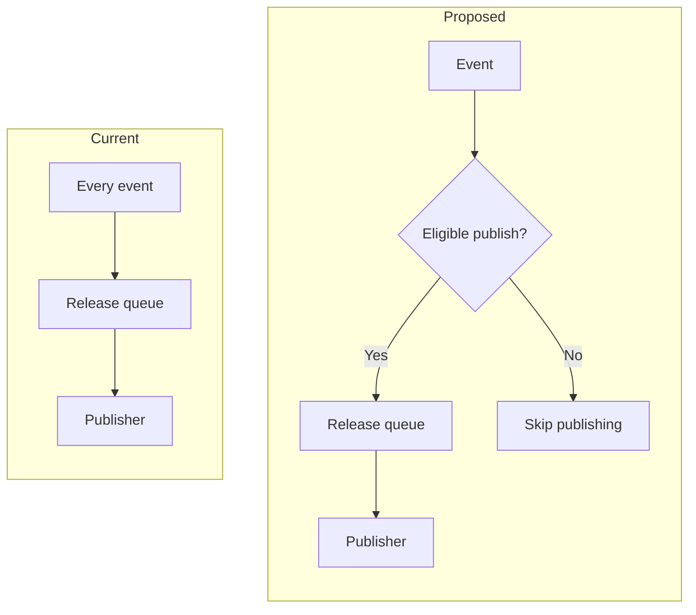

# Before-and-after comparisons

Show one behavior change per comparison. Label the two views **Current** and
**Proposed**, keeping their terminology and level of detail aligned. Show the
relevant trigger, decision, and outcome on each side; include unchanged steps
only when they make the difference understandable. Use side-by-side subgraphs
when they fit comfortably, or stack the views for a narrower document.

This illustrative example shows a queue moving behind an eligibility check:

Irrelevant events stay outside the release queue, so they cannot displace a
queued publish.

**Location:** `path/to/workflow.yml` — workflow routing and publish-job
concurrency. Replace this illustrative path and behavior with the target
plan's inspected locations and conditions.

The diagram explains the behavior; the accompanying change entry records any
implementation choices that the picture leaves implicit.
